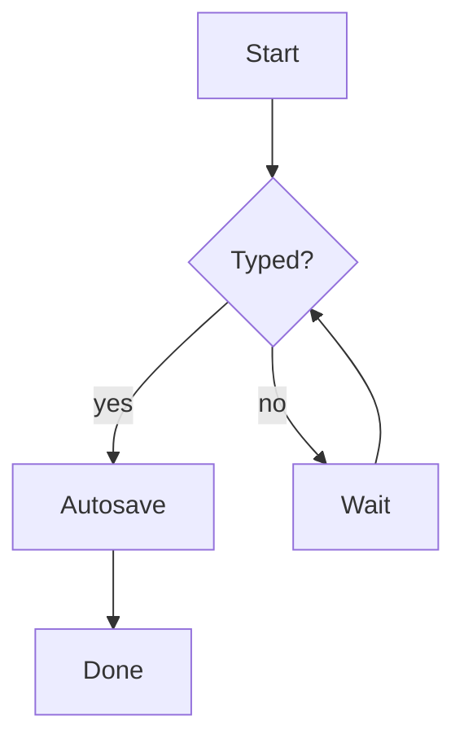
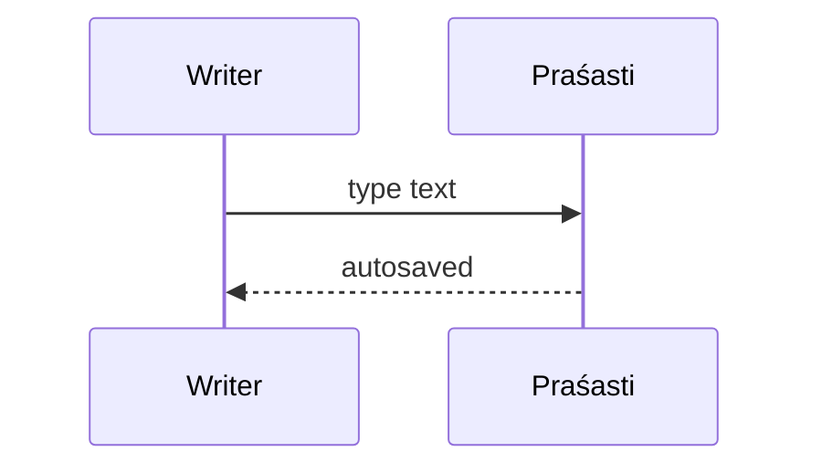
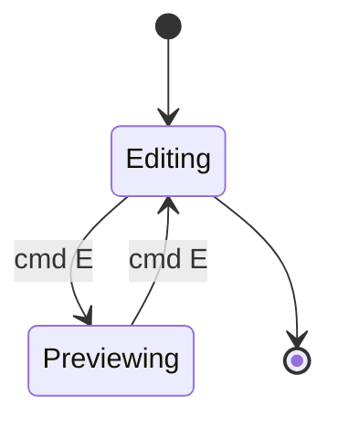
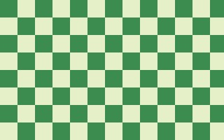
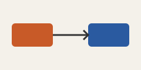

# Kitchen sink

A fixture for checking every Markdown feature in Edit and Preview. Do not edit it by hand: tests expect its exact content.

## Headings

# Heading 1
## Heading 2
### Heading 3
#### Heading 4
##### Heading 5
###### Heading 6

Setext heading 1
================

Setext heading 2
----------------

## Paragraphs

This is a long paragraph that keeps going well past eighty columns, so that the editor has to wrap it at the column width and Preview has to wrap it at its reading width, with enough words in it that several wrapped lines appear in either mode.

A hard line break follows this line with two spaces.  
This line starts after the break, and the next one uses a backslash\
so it breaks as well.

Inline styles: *italic*, **bold**, ***both***, ~~strike~~, `code`, and escaped characters: \*not italic\*, \`not code\`, \# not a heading, 1\. not a list.

## Links

- Inline: [Rust](https://www.rust-lang.org "The Rust language")
- Reference style: [the spec][spec] and [collapsed][].
- Autolink: <https://example.com/autolink>
- Bare URL (GFM): https://example.com/bare
- Fragment: [back to Headings](#headings)
- Mail: [write to us](mailto:hello@example.com)

[spec]: https://spec.commonmark.org/
[collapsed]: https://example.com/collapsed

## Lists

- Unordered one
- Unordered two
- Unordered three

1. Ordered from one
2. Second
3. Third

7) Ordered from seven
8) Eight
9) Nine

* Level one
  1. Level two, ordered
     - Level three, unordered
     - Another level three
  2. Level two again
* Level one again

+ [x] Done task
+ [ ] Open task
+ [ ] Another open task

- A loose item with two paragraphs.

  The second paragraph of the first item.

- A second loose item.

  Its second paragraph, with `code` in it.

## Block quotes

> A quote.
>
> > A nested quote.
> > It wraps onto a second line.
>
> Back in the outer quote.

> A quote with a list and code:
>
> - first
> - second
>
> ```rust
> fn quoted() -> u8 { 42 }
> ```

## Code

```rust
fn main() {
    let words = ["write", "never", "lose"];
    println!("{}", words.join(" "));
}
```

```swift
struct Note { var title: String; var body: String }
let note = Note(title: "Hi", body: "There")
print(note.title)
```

```js
const sum = (a, b) => a + b;
console.log(sum(1, 2));
```

```json
{ "name": "prasasti", "tags": ["markdown", "writer"], "count": 3 }
```

```bash
echo "hello" | tr a-z A-Z
```

```python
def walk(tree, depth=0):
    for child in tree.children:
        if child.is_leaf:
            print("  " * depth + child.name)
        else:
            walk(child, depth + 1)
```

```html
<ul class="notes">
  <li><a href="/a">Alpha</a></li>
  <li>
    <em>Beta</em>
  </li>
</ul>
```

```klingon
qapla' this language is unknown
```

```
A fence with no language.
```

    An indented code block.
    Second line.

```text
This single line is deliberately very long so that it must scroll horizontally in Preview instead of wrapping: 0123456789 0123456789 0123456789 0123456789 0123456789 0123456789 0123456789 0123456789 0123456789 0123456789 the end.
```

## Tables

| Left | Centre | Right |
|:-----|:------:|------:|
| a    |   b    |     c |
| `code` | [link](https://example.com) | 12345 |

| Column one | Column two | Column three | Column four | Column five | Column six | Column seven | Column eight |
|------------|------------|--------------|-------------|-------------|------------|--------------|--------------|
| A fairly long cell value | Another fairly long cell value | Yet another long cell value | More text here | And more here | Still more | Even more | The last one |

## Footnotes

A sentence with a footnote.[^1] And another one.[^note]

[^1]: The first footnote.
[^note]: A named footnote, with `code`.

---

**Term**
: A definition-style bold term followed by its explanation.

## Math

Inline: $e^{i\pi}+1=0$ sits in a sentence.

$$\int_0^1 x^2\,dx = \frac{1}{3}$$

$$\begin{pmatrix} 1 & 2 \\ 3 & 4 \end{pmatrix}$$

The next block is invalid and must fail alone:

$$\frac{1}{$$

## Mermaid







```mermaid
flowchart TD
    A --> --> [ broken
```

## Images

Relative PNG: 

Relative JPEG in a subfolder: 

Relative SVG: 

A file name with a space: 

Remote: 

Data URI: 

Broken: 

## Raw HTML

Inline SVG: <svg width="60" height="20" xmlns="http://www.w3.org/2000/svg"><rect width="60" height="20" fill="#c85a28"/></svg>

<details>
<summary>Click to expand</summary>

Hidden content inside details.

</details>

Press <kbd>Cmd</kbd> + <kbd>E</kbd> to toggle Preview.

CSP probe, which must never run:

<script>window.__xss = 1</script>


## Non-ASCII

日本語の文章はスペースなしで続きます。書き手は入力したテキストを決して失ってはいけません。この段落は十分に長く、エディタの列幅で折り返されることを確認するためのものです。中文段落也没有空格,用来检查换行:写作者输入的文字绝不能丢失。

كتابة النص بالعربية تسير من اليمين إلى اليسار، وهذه الفقرة طويلة بما يكفي لتلتف على عدة أسطر عند عرض العمود المحدد في المحرر، مع كلمات كثيرة تفصل بينها مسافات.

Combining marks: café (e plus U+0301), naïve, Zürich, and a long run of accented words such as résumé, façade, jalapeño, and Ångström written with combining accents, repeated to wrap: résumé façade jalapeño Ångström résumé façade jalapeño.

Emoji: 😀 🎉 👩‍💻 🇮🇩 👨‍👩‍👧‍👦 ✍️ plus more words around them so that the line wraps past the column width, 😀 🎉 👩‍💻 🇮🇩 ✍️ and so on until the end of the line.
